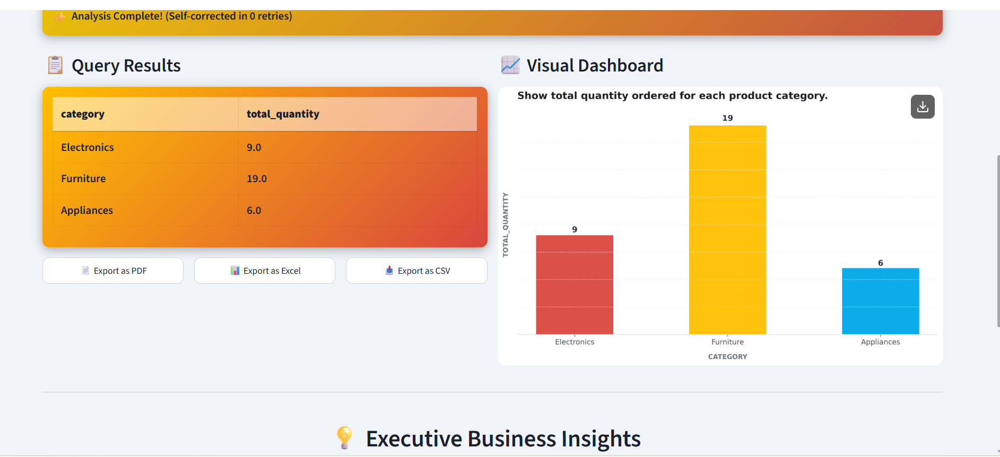
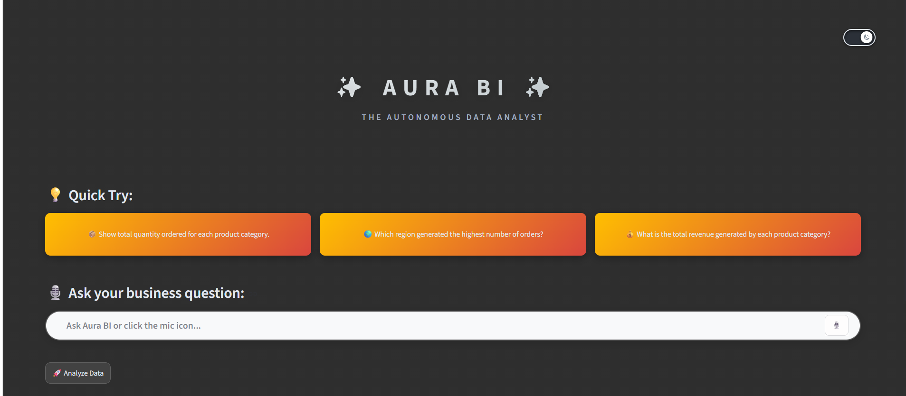
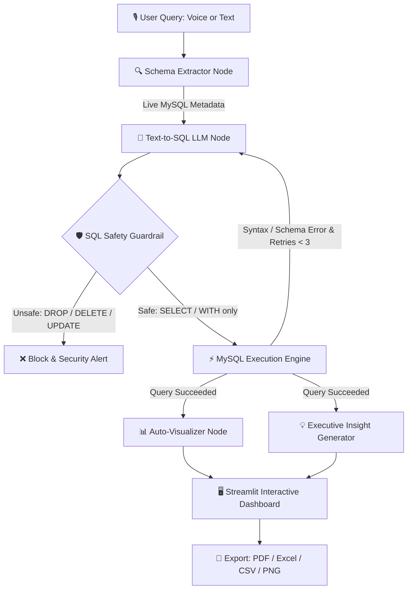

<div align="center">

# ✨ AURA BI
### Autonomous Business Intelligence & Self-Healing SQL Agent

[](https://python.org)
[](https://langchain-ai.github.io/langgraph/)
[](https://groq.com)
[](https://mysql.com)
[](https://streamlit.io)

</div>

---

## 🎯 Overview

**Aura BI** is an autonomous, full-stack Business Intelligence agent that transforms natural language and voice queries into validated SQL, live database analytics, automated visualizations, and executive summaries. Built on a stateful **LangGraph** architecture, it automatically detects and self-corrects SQL execution errors without human intervention.

---

## 📸 Dashboard UI Showcase

### ☀️ Light Mode — Executive Insights & Multi-Format Export


### 🌙 Dark Mode — Neumorphic Interface & Auto-Charting


### 🛠️ Engineered Architecture & Custom Footer


---

## 🏗️ Autonomous Agent Architecture



---

## 🚀 Core Engineering Features

| Module | Technical Implementation |
| :--- | :--- |
| **Self-Healing SQL Loop** | Stateful `StateGraph` captures MySQL tracebacks and iterates up to 3 times to auto-correct column names, joins, or syntax errors. |
| **Read-Only Guardrail** | Pre-execution regex and keyword validation restricts queries strictly to `SELECT` and `WITH` CTE statements. |
| **Dynamic Visualization** | Evaluates returned DataFrame dimensionality and renders Matplotlib charts automatically with hover-to-download support. |
| **Voice & Text Input** | Unified Gemini-style search bar with embedded `streamlit-mic-recorder` speech-to-text and conditional clear controls. |
| **State-Persistent Exports** | Uses `st.session_state` caching to export query results to **PDF**, **Excel (`.xlsx`)**, and **CSV** without UI resets. |

---

## ⚙️ Local Installation & Setup

1. **Clone the repository**
   ```bash
   git clone [https://github.com/Ashi72jadoun/autonomous-data-analyst.git](https://github.com/Ashi72jadoun/autonomous-data-analyst.git)
   cd autonomous-data-analyst
   ```

2. **Create and activate the virtual environment**
   ```powershell
   python -m venv venv
   .\venv\Scripts\Activate.ps1
   ```

3. **Install required packages**
   ```powershell
   pip install -r requirements.txt
   ```

4. **Configure environment variables**
   Create a `.env` file in the root directory:
   ```env
   GROQ_API_KEY=your_groq_api_key
   DB_HOST=localhost
   DB_USER=root
   DB_PASSWORD=your_mysql_password
   DB_NAME=your_database_name
   ```

5. **Launch Aura BI**
   ```powershell
   streamlit run app.py
   ```

---

<div align="center">
  <b>Aura BI | Engineered with Python, LangGraph, MySQL & Groq by AJ :)</b>
</div>