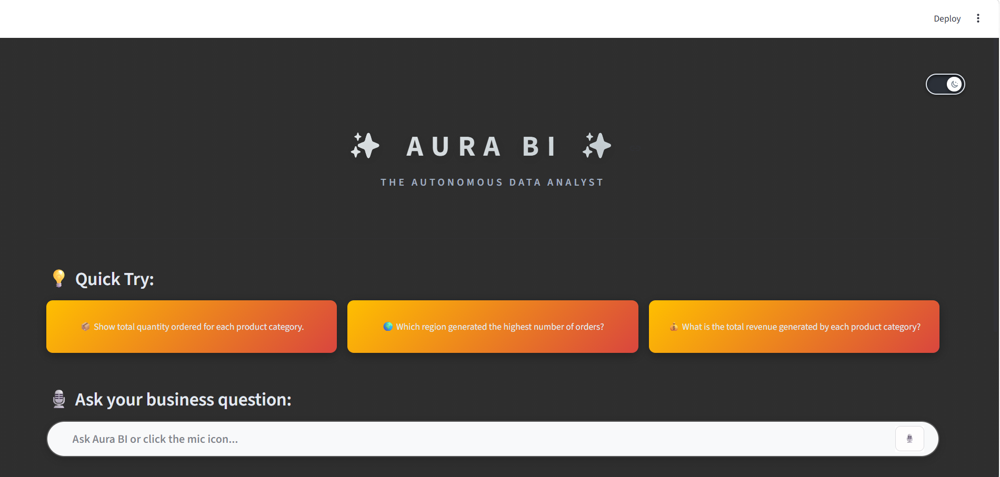
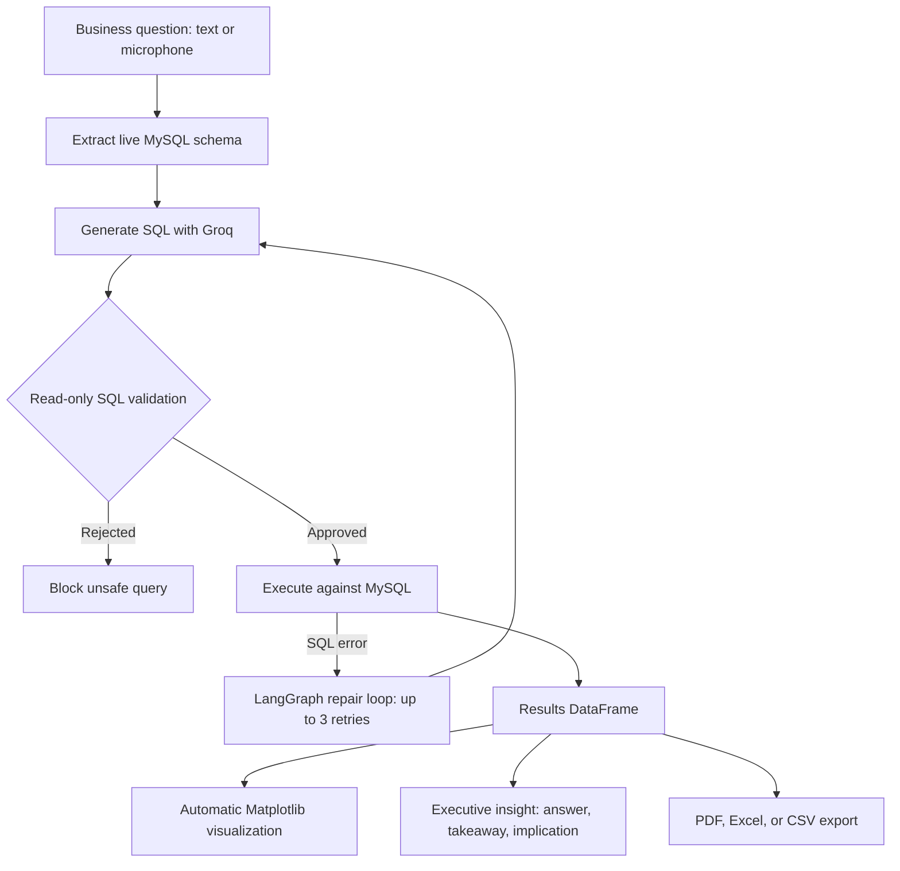

# ✨ AURA BI — Ask. Analyze. Act.

<p align="center">
  <strong>Your autonomous, voice-enabled data analyst.</strong><br>
  Ask in plain English—or use the microphone—to turn live data into SQL results, visualizations, and executive-ready insights.
</p>

<p align="center">
  
</p>

<p align="center">
  <sub><strong>01 · The AURA Command Center</strong> — Start with a quick prompt, type a question, or ask it by voice.</sub>
</p>

---

## 🎬 AURA in Action

### ☀️ The Brightside Dashboard — Results, charts, and exports

<p align="center">
  
</p>

### 💡 Insight to Action — An executive-ready business brief

<p align="center">
  
</p>

### 🌗 Day & Night — Your workspace, your way

<p align="center">
  
</p>

---

## 🎯 What AURA BI Does

AURA BI is a full-stack business intelligence agent that converts **text or voice questions** into validated SQL, live MySQL analytics, visualizations, and business-focused summaries. Its LangGraph workflow can detect SQL execution errors and attempt to repair the query automatically.

| Capability | How it works |
|---|---|
| 🎙️ **Voice and text input** | A unified chat-style input supports typed questions and microphone input using `streamlit-mic-recorder` and speech-to-text, with clear controls. |
| ⚡ **Quick-start prompts** | Clickable example questions help you explore the data right away. |
| 🔎 **Live schema extraction** | Reads MySQL metadata to ground SQL generation in the available tables and columns. |
| 🧠 **Natural-language-to-SQL** | Uses an LLM workflow to translate business questions into SQL. |
| 🛡️ **Read-only SQL guardrail** | Pre-execution checks restrict queries to `SELECT` and `WITH` CTE patterns and block write or destructive statements. |
| 🔁 **Self-healing SQL loop** | A stateful LangGraph workflow captures MySQL errors and can retry SQL correction up to **3 times**. |
| 📊 **Automatic visualizations** | Evaluates the returned DataFrame and generates Matplotlib charts, with hover-to-download support. |
| 💼 **Executive business insights** | Summarizes results as a direct answer, key takeaway, and business implication. |
| 📤 **PDF, Excel, and CSV exports** | Export results in PDF, `.xlsx`, or CSV format; Streamlit session state helps keep results available across UI reruns. |
| 🌗 **Light and dark modes** | Switch between the two dashboard themes. |

## 🧠 Agent Workflow



## 💬 Try These Questions

- “Show total quantity ordered for each product category.”
- “Which region generated the highest number of orders?”
- “What is the total revenue generated by each product category?”

## 🧰 Tech Stack

**Python · Streamlit · LangGraph · Groq · MySQL · Matplotlib**

## 🚀 Run Locally

### 1. Clone the repository

Replace `YOUR-USERNAME` with your GitHub username. If you already have the repository cloned, use your existing project folder.

```bash
git clone https://github.com/Ashi72jadoun/autonomous-data-analyst.git
cd autonomous-data-analyst
```

### 2. Create and activate a virtual environment

```bash
python -m venv .venv
```

**Windows PowerShell**
```powershell
.\.venv\Scripts\Activate.ps1
```

**macOS / Linux**
```bash
source .venv/bin/activate
```

### 3. Install dependencies

```bash
pip install -r requirements.txt
```

### 4. Configure environment variables

Create a `.env` file in the project root:

```env
GROQ_API_KEY=your_groq_api_key
DB_HOST=localhost
DB_USER=your_read_only_mysql_user
DB_PASSWORD=your_mysql_password
DB_NAME=your_database_name
```

Keep `.env` out of Git and never publish real API keys or database credentials. For stronger protection, connect using a MySQL account with read-only permissions; an application-level guardrail should not replace database permissions.

### 5. Launch AURA BI

```bash
streamlit run app.py
```

## 🗂️ Key Project Files

| File | Purpose |
|---|---|
| `app.py` | Streamlit interface and dashboard |
| `agent_runner.py`, `graph_agent.py` | Agent execution and LangGraph workflow |
| `schema_extractor.py` | MySQL schema and metadata extraction |
| `text_to_sql.py` | Natural-language-to-SQL generation |
| `sql_validator.py` | SQL safety validation |
| `db_connect.py` | MySQL connection |
| `data_visualizer.py` | Automatic chart generation |
| `insight_generator.py` | Executive summaries and business insights |
| `requirements.txt` | Python dependencies |
| `assets/screenshots/` | README product-tour images |

---

<p align="center">
  <strong>✨ AURA BI — From questions to decisions.</strong><br>
  Built with Python, LangGraph, MySQL, and Groq · by AJ
</p>