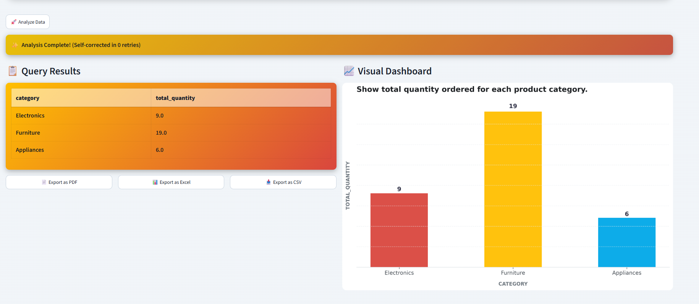
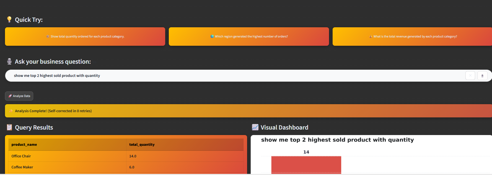
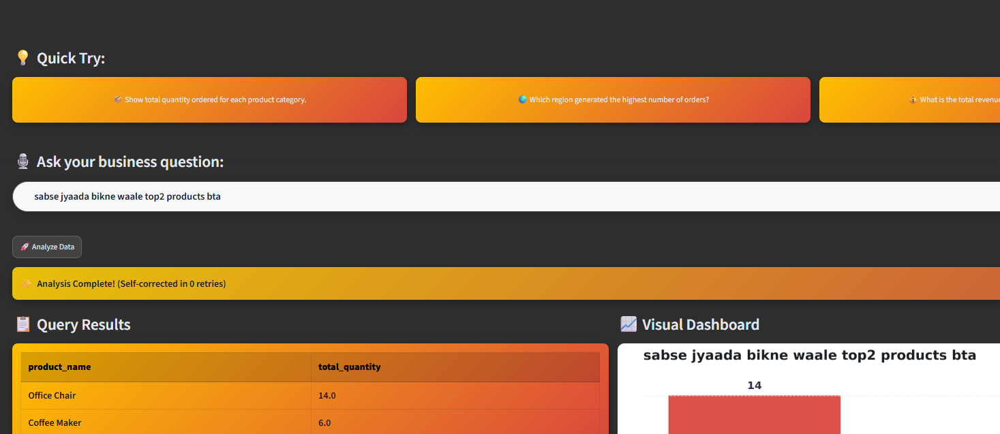
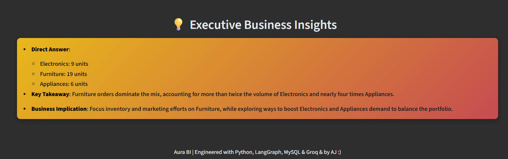
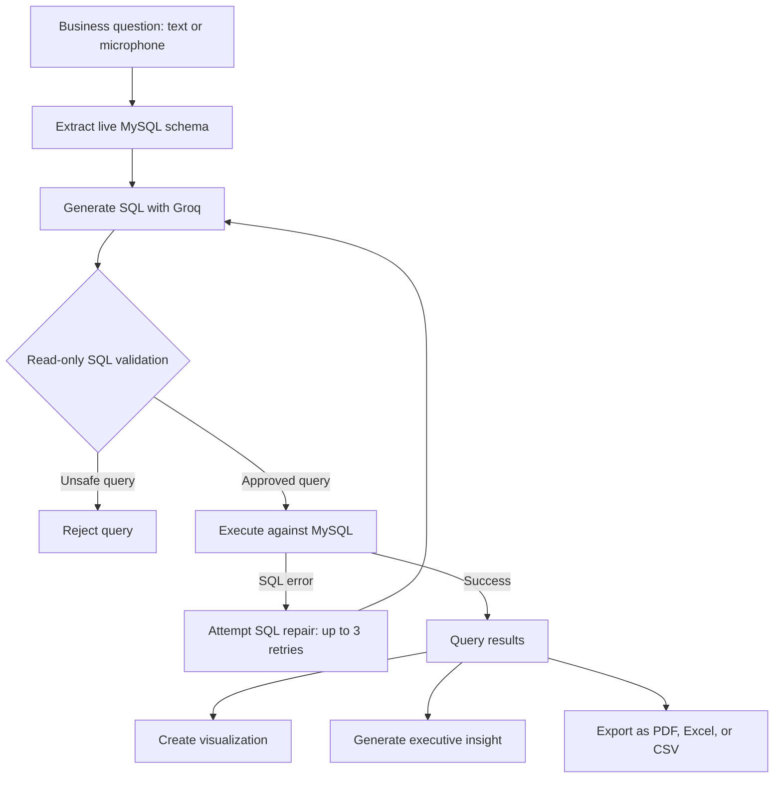

<div align="center">

<h1>✨ AURA BI</h1>
<h3>THE AUTONOMOUS DATA ANALYST</h3>

<p>
  
  
  
  
  
  
</p>

<p>
  <strong>Ask. Analyze. Act.</strong><br />
  Ask questions about your business data in English, Hindi, Hinglish, or another
  language supported by your configured AI model. Type your question or use the
  microphone, then get results, charts, and business insights.
</p>

</div>

---

## 📸 AURA BI in Action

### 1. The AURA Command Center

<p align="center">
  
</p>

<p align="center">
  <sub>Start with a suggested question, type your own, or use the microphone.</sub>
</p>

### 2. Results, Charts & Exports

<p align="center">
  
</p>

<p align="center">
  <sub>See query results and visualizations, then export your results as PDF, Excel, or CSV.</sub>
</p>

### 3. Ask in English

<p align="center">
  
</p>

### 4. Ask in Hinglish

<p align="center">
  
</p>

<p align="center">
  <sub>Ask in the language that feels natural to you. The AI model must support the language you use.</sub>
</p>

### 5. From Results to Business Insights

<p align="center">
  
</p>

---

## 🎯 What AURA BI Does

AURA BI turns questions about your data into validated SQL, live MySQL results, visualizations, and clear business takeaways.

| Feature | What it does |
|---|---|
| 🌍 **Questions in your language** | Type questions in English, Hindi, Hinglish, or another language understood by the configured AI model. |
| 🎙️ **Microphone input** | Ask by voice using the microphone. Spoken-language support depends on the speech-recognition setup. |
| ⚡ **Quick questions** | Use suggested prompts to explore your data faster. |
| 🔎 **Live schema extraction** | Reads MySQL metadata to help the AI use the tables and columns in your database. |
| 🧠 **Natural-language-to-SQL** | Converts business questions into SQL queries. |
| 🛡️ **Read-only SQL guardrail** | Checks queries before execution and permits `SELECT` and `WITH` query patterns. |
| 🔁 **Self-healing SQL** | Uses query errors to try to correct failed SQL, with up to 3 retries. |
| 📊 **Automatic charts** | Creates Matplotlib visualizations from query results. |
| 💡 **Executive insights** | Presents a direct answer, key takeaway, and business implication. |
| 📤 **Multi-format exports** | Download results as PDF, Excel, or CSV. |

> **Language note:** Hinglish text input is demonstrated above. Results depend on the language abilities of your configured AI model. Voice recognition can have additional language limitations depending on its setup.

## 🧠 How the Agent Works



## 💬 Questions to Try

- “Show total quantity ordered for each product category.”
- “Which region generated the highest number of orders?”
- “What is the total revenue for each product category?”
- “Show me the top 2 highest-selling products with quantity.”
- “Sabse zyada bikne wale top 2 products batao.”

## 🧰 Technology Stack

- **Application:** Python, Streamlit
- **Agent workflow:** LangGraph
- **AI:** Groq
- **Database:** MySQL
- **Visualizations:** Matplotlib

## 🚀 Run Locally

### 1. Clone the repository

Replace `YOUR-USERNAME` with your GitHub username.

```bash
git clone https://github.com/YOUR-USERNAME/autonomous-data-analyst.git
cd autonomous-data-analyst
```

### 2. Create and activate a virtual environment

```bash
python -m venv .venv
```

**Windows PowerShell**

```powershell
.\.venv\Scripts\Activate.ps1
```

**macOS / Linux**

```bash
source .venv/bin/activate
```

### 3. Install dependencies

```bash
pip install -r requirements.txt
```

### 4. Configure your environment

Create a `.env` file in the project root:

```env
GROQ_API_KEY=your_groq_api_key
DB_HOST=localhost
DB_USER=your_read_only_mysql_user
DB_PASSWORD=your_mysql_password
DB_NAME=your_database_name
```

Keep `.env` private and out of Git. For additional protection, use a MySQL account with read-only permissions. The application's SQL checks should not replace database permissions.

### 5. Start AURA BI

```bash
streamlit run app.py
```

## 🗂️ Project Files

| File | Purpose |
|---|---|
| `app.py` | Streamlit application and dashboard |
| `agent_runner.py` | Runs the analysis agent |
| `graph_agent.py` | LangGraph agent workflow |
| `schema_extractor.py` | Extracts database schema information |
| `text_to_sql.py` | Generates SQL from questions |
| `sql_validator.py` | Checks queries before execution |
| `db_connect.py` | Connects to MySQL |
| `data_visualizer.py` | Creates charts from query results |
| `insight_generator.py` | Generates business insights |
| `requirements.txt` | Python dependencies |
| `assets/screenshots/` | README screenshots |

---

<p align="center">
  <strong>✨ AURA BI — From questions to decisions.</strong><br />
  Built with Python, Streamlit, LangGraph, Groq, and MySQL · by AJ
</p>